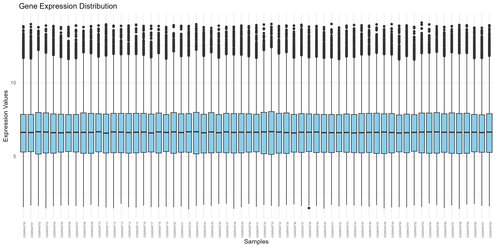
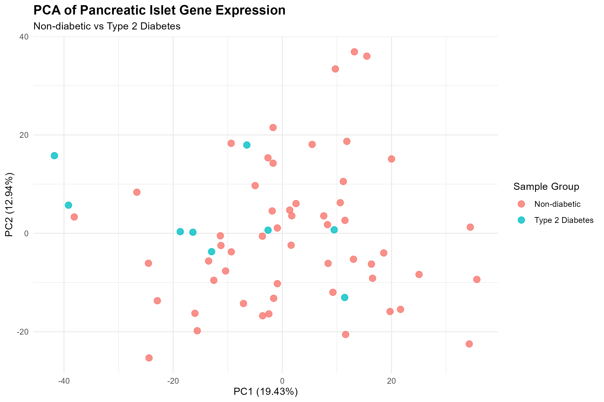
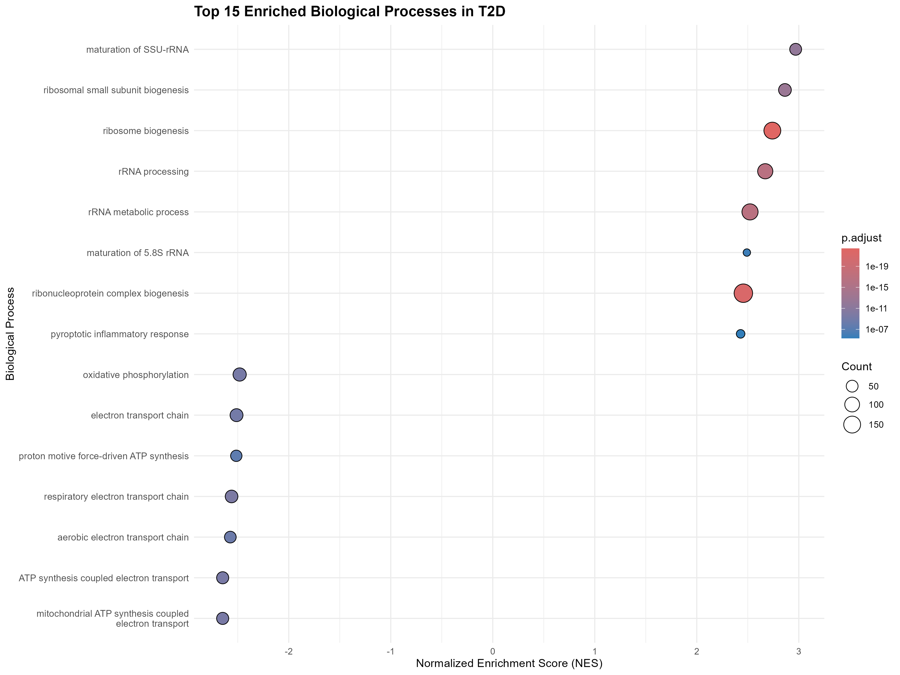
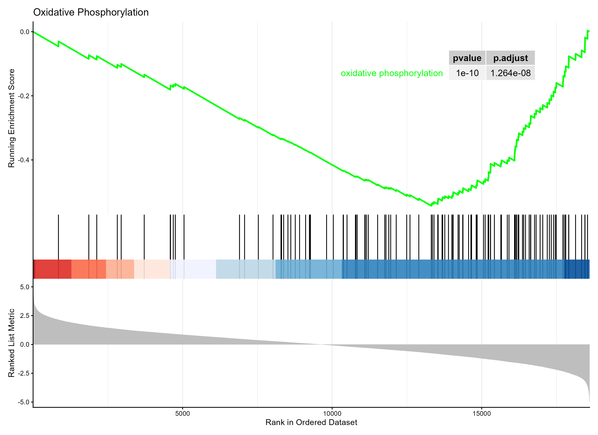

# Bioinformatics Analysis of Type 2 Diabetes Using Pancreatic Islet Gene Expression Data


## 1. Title and Abstract


### Title

**Differential Gene Expression and Functional Enrichment Analysis of Type 2 Diabetes Using Pancreatic Islet Gene Expression Data**


### Abstract


This study analyzes gene expression differences between Type 2 Diabetes (T2D) and non-diabetic individuals using the public GEO dataset GSE38642. The dataset contains pancreatic islet expression profiles from 63 human donors, including 9 T2D and 54 non-diabetic samples. Data inspection, quality control, principal component analysis (PCA), differential gene expression analysis using limma, probe annotation, and Gene Ontology (GO) enrichment analysis using Gene Set Enrichment Analysis (GSEA) were performed in R. One probe showed statistically significant differential expression after multiple-testing correction. GSEA identified 1,245 GO Biological Process pathways with adjusted p-values below 0.05. The findings highlight potential differences in ribosome-related, immune-related, and mitochondrial energy metabolism processes. These results are exploratory and require further validation.


---


## 2. Introduction


Type 2 Diabetes (T2D) is a chronic metabolic disease that affects the body's ability to regulate blood glucose levels. Pancreatic islets play an important role in blood glucose regulation because they contain insulin-producing beta cells.


Gene expression analysis helps researchers understand how genes behave under different biological conditions. Comparing gene expression between diabetic and non-diabetic individuals can help identify genes and biological processes potentially associated with T2D.


### Research Problem


Understanding gene expression differences between T2D and non-diabetic individuals is important for investigating the molecular processes associated with diabetes.


### Aim


To identify differentially expressed probes and explore biological processes associated with Type 2 Diabetes using pancreatic islet gene expression data.


### Objectives


1. Obtain and inspect a public gene expression dataset.

2. Perform data quality checks and visualization.

3. Explore sample distribution using PCA.

4. Identify differentially expressed probes using limma.

5. Annotate significant probes using platform annotation.

6. Identify enriched biological processes using GSEA.


---


## 3. Data Description


### Dataset Information


| Attribute | Description |
|---|---|
| Dataset ID | GSE38642 |
| Source | NCBI Gene Expression Omnibus (GEO) |
| Platform | GPL6244 |
| Platform technology | Affymetrix Human Gene 1.0 ST |
| Organism | Homo sapiens |
| Tissue | Pancreatic islets |
| Total samples | 63 |
| Non-diabetic samples | 54 |
| T2D samples | 9 |
| Expression probes | 18,808 |


### Data Source


The gene expression dataset was downloaded from the NCBI Gene Expression Omnibus.


Dataset: [NCBI GEO – GSE38642](https://www.ncbi.nlm.nih.gov/geo/query/acc.cgi?acc=GSE38642)


Platform: [NCBI GEO – GPL6244](https://www.ncbi.nlm.nih.gov/geo/query/acc.cgi?acc=GPL6244)


### Data Structure


The expression matrix contains:


- Rows representing probes.

- Columns representing biological samples.

- Numerical values representing gene expression levels.


The expression matrix contains 18,808 probes and 63 samples.


The expression data were already normalized using the Robust Multi-array Average (RMA) method according to the GEO data processing information.


### Ethical and Licensing Considerations


This analysis uses an existing publicly available GEO dataset. No new patient recruitment or direct patient data collection was performed for this computational analysis.


The original study's ethical approval, consent arrangements, and GEO data-use conditions should be acknowledged when describing the source data. No personally identifying information was used in this analysis.


---


## 4. Methods


The analysis was performed using R and RStudio.


### 4.1 Software and Packages


The following R packages were used:


| Package | Purpose |
|---|---|
| GEOquery | Download and access GEO datasets |
| limma | Differential gene expression analysis |
| tidyverse | Data manipulation |
| ggplot2 | Data visualization |
| dplyr | Data filtering and manipulation |
| clusterProfiler | GO enrichment and GSEA |
| org.Hs.eg.db | Human gene annotation |
| AnnotationDbi | Gene identifier annotation |
| enrichplot | Enrichment visualization |
| gridExtra | Plot arrangement |
| stringr | Text processing |


### 4.2 Dataset Download and Inspection


The GSE38642 dataset was downloaded using GEOquery.


The expression matrix and sample metadata were extracted from the ExpressionSet object.


The following checks were performed:


- Dataset dimensions.

- Sample metadata inspection.

- Missing-value detection.

- Duplicate sample-name detection.

- Expression value summary.


The dataset contained 18,808 probes and 63 samples.


No missing values were found in the expression matrix or sample information. No duplicate sample names were identified.


### 4.3 Quality Control


A boxplot was generated to inspect the distribution of gene expression values across samples.


The expression values had the following summary:


| Statistic | Expression value |
|---|---:|
| Minimum | 1.410 |
| First quartile | 5.250 |
| Median | 6.630 |
| Mean | 6.591 |
| Third quartile | 7.900 |
| Maximum | 14.070 |


The boxplot was used to visually examine differences in expression distributions between samples.


**Figure 1: Expression distribution across samples****





### 4.4 Principal Component Analysis (PCA)


PCA was performed to explore variation among the 63 samples.


The expression matrix was transposed so that rows represented samples and columns represented probes.


The `prcomp()` function was used to perform PCA.


The first two principal components explained:


- PC1: 19.43% of the variance.

- PC2: 12.94% of the variance.


Together, PC1 and PC2 explained 32.37% of the total variation.


**Figure 2: PCA of pancreatic islet gene expression****





### 4.5 Differential Gene Expression Analysis


The limma package was used to identify differences in gene expression between T2D and non-diabetic samples.


The samples were divided into two groups:


- Control: 54 non-diabetic samples.

- T2D: 9 Type 2 Diabetes samples.


A design matrix was created, followed by the contrast:


`T2D - Control`


The `lmFit()`, `contrasts.fit()`, and `eBayes()` functions were used to perform the analysis.


The Benjamini-Hochberg method was used to adjust p-values for multiple testing.


A probe was considered statistically significant when:


`Adjusted p-value < 0.05`


The differential expression results were saved in:

[Open the complete differential expression results table](results/tables/differential_expression_results.csv)

**Preview: statistically significant probe(s)**

| Probe_ID | logFC | AveExpr | t | P.Value | adj.P.Val | Regulation |
| --- | --- | --- | --- | --- | --- | --- |
| 8072314 | 0.33851851851852 | 5.59206349206349 | 5.18632831107516 | 2.26298922505407e-06 | 0.0425623013448169 | Not Significant |


### 4.6 Probe Annotation


The GPL6244 platform annotation file was used to connect probe identifiers with available gene annotation information.


The differential expression results were joined with the platform annotation using probe IDs.


The significant probe was further examined using human gene annotation resources.


The annotated results were saved in the following CSV table. Click the link to open the complete table on GitHub:

[Open the complete annotated gene results table](results/tables/annotated_gene_results.csv)

**Preview: annotated significant probe(s)**

| Probe_ID | logFC | adj.P.Val | GB_LIST | SPOT_ID |
| --- | --- | --- | --- | --- |
| 8072314 | 0.33851851851852 | 0.0425623013448169 | BC008289 | chr22:30641984-30642907 |


### 4.7 Gene Ontology Enrichment Analysis Using GSEA


Gene Set Enrichment Analysis was performed using the `gseGO()` function from clusterProfiler.


The ranked gene list was generated using limma moderated t-statistics.


The analysis used:


- Organism database: `org.Hs.eg.db`

- Identifier type: `ENTREZID`

- Ontology: Biological Process (BP)

- Minimum gene set size: 10

- Maximum gene set size: 500

- Multiple-testing correction: Benjamini-Hochberg

- Significance threshold: adjusted p-value < 0.05

- Numerical precision setting: `eps = 0`


The results were saved in the following CSV table. Click the link to open all 5,688 pathway results on GitHub:

[Open the complete GO GSEA results table](results/tables/GO_GSEA_final_results.csv)

**Preview: top 15 enriched pathways**

| Description | NES | pvalue | p.adjust |
| --- | --- | --- | --- |
| ribosome biogenesis | 2.74077687106033 | 7.13496849175098e-27 | 4.05837007810795e-23 |
| ribonucleoprotein complex biogenesis | 2.45658704903108 | 1.7595195336550702e-25 | 5.00407355371501e-22 |
| cytokine-mediated signaling pathway | 2.32927165782257 | 1.00048721220691e-21 | 1.8969237543443e-18 |
| rRNA metabolic process | 2.52181198134373 | 1.48412273778704e-20 | 2.11042253313317e-17 |
| rRNA processing | 2.67110501862872 | 2.21138240488369e-20 | 2.5156686237956902e-17 |
| leukocyte migration | 2.36950934131605 | 5.80545741175467e-18 | 5.5035736263434204e-15 |
| ribosomal small subunit biogenesis | 2.86421655172347 | 2.3104399880118797e-16 | 1.87739752168736e-13 |
| maturation of SSU-rRNA | 2.96928904929299 | 1.8305379014436403e-15 | 1.30151244792643e-12 |
| cell chemotaxis | 2.28096250575637 | 5.241660515907931e-15 | 3.31272944605381e-12 |
| humoral immune response | 2.33078842818591 | 9.54985646076125e-15 | 4.6475460810890195e-12 |
| chemotaxis | 2.11729856159918 | 9.80494953816249e-15 | 4.6475460810890195e-12 |
| taxis | 2.11729856159918 | 9.80494953816249e-15 | 4.6475460810890195e-12 |
| positive regulation of cell adhesion | 2.0982372422499 | 2.28868478062717e-14 | 1.0013876178621e-11 |
| epidermis development | 2.21668989976535 | 2.66618601403963e-13 | 1.0832332891326701e-10 |
| respiratory electron transport chain | -2.56046266209579 | 4.54172612656539e-13 | 1.72222254719359e-10 |


The top enriched pathways were visualized using a GSEA dot plot.


---


## 5. Results


### 5.1 Dataset Quality Assessment


The dataset contained 18,808 probes and 63 samples.


The quality checks identified:


- Missing expression values: 0

- Missing sample metadata values: 0

- Duplicate sample names: 0


The expression values ranged from 1.410 to 14.070.


The boxplot provided a visual summary of expression distributions across samples.


### 5.2 PCA Results


The PCA analysis showed:


| Component | Variance explained |
|---|---:|
| PC1 | 19.43% |
| PC2 | 12.94% |
| Combined | 32.37% |


The PCA plot provides an overview of variation among the samples. Any separation between groups should be interpreted visually rather than assumed to demonstrate complete separation.

**Preview: first 10 PCA samples**

| Sample | PC1 | PC2 | Group |
| --- | --- | --- | --- |
| GSM946700 | -10.3955271193022 | -7.6522088227503 | Non-diabetic |
| GSM946701 | 18.5759894860632 | -3.99488359283263 | Non-diabetic |
| GSM946702 | -3.61264972794743 | -16.7576265516565 | Non-diabetic |
| GSM946703 | 19.7287277797393 | -15.8958450652959 | Non-diabetic |
| GSM946704 | -24.5309326418047 | -6.08432646853261 | Non-diabetic |
| GSM946705 | 13.1943838579694 | 36.8930547783246 | Non-diabetic |
| GSM946706 | 5.46117089839082 | 18.0701224680457 | Non-diabetic |
| GSM946707 | 11.1711822315204 | 10.5427487534347 | Non-diabetic |
| GSM946708 | -13.5139663604751 | -5.63455067116178 | Non-diabetic |
| GSM946709 | -2.47485386593821 | -16.3812968596366 | Non-diabetic |


[Open all 63 PCA sample results](results/tables/PCA_results.csv)

The full sample-level PCA coordinates are available in [PCA_results.csv](results/tables/PCA_results.csv). The table below previews the first 10 samples:

| Sample | PC1 | PC2 | Group |
| --- | --- | --- | --- |
| GSM946700 | -10.3955271193022 | -7.6522088227503 | Non-diabetic |
| GSM946701 | 18.5759894860632 | -3.99488359283263 | Non-diabetic |
| GSM946702 | -3.61264972794743 | -16.7576265516565 | Non-diabetic |
| GSM946703 | 19.7287277797393 | -15.8958450652959 | Non-diabetic |
| GSM946704 | -24.5309326418047 | -6.08432646853261 | Non-diabetic |
| GSM946705 | 13.1943838579694 | 36.8930547783246 | Non-diabetic |
| GSM946706 | 5.46117089839082 | 18.0701224680457 | Non-diabetic |
| GSM946707 | 11.1711822315204 | 10.5427487534347 | Non-diabetic |
| GSM946708 | -13.5139663604751 | -5.63455067116178 | Non-diabetic |
| GSM946709 | -2.47485386593821 | -16.3812968596366 | Non-diabetic |


### 5.3 Differential Expression Results


The limma analysis identified one probe with an adjusted p-value below 0.05.

**Significance category counts**

| Category | Count |
| --- | --- |
| Total probes | 18808 |
| Adjusted P-value < 0.05 | 1 |
| Upregulated | 0 |
| Downregulated | 0 |


[Open the significance summary CSV](results/tables/significance_summary.csv)


| Attribute | Result |
|---|---:|
| Probe ID | 8072314 |
| logFC | +0.3385185 |
| Average expression | 5.592063 |
| Moderated t-statistic | 5.186328 |
| P-value | 2.262989 × 10⁻⁶ |
| Adjusted p-value | 0.04256230 |


The positive log fold change indicates higher expression in the T2D group relative to the control group for this probe.


The fold change is approximately 1.26, indicating a modest expression difference.


### 5.4 Probe Annotation Results


The significant probe, 8072314, was associated with the annotation for **LIF-AS2 (LIF antisense RNA 2)**.


The annotation identifies it as an antisense RNA rather than a protein-coding gene.


No GO annotations were returned for this identifier in the queried `org.Hs.eg.db` resource. This means no corresponding GO annotations were found through that particular mapping; it does not establish that the RNA has no biological function.


### 5.5 GSEA Results


The final GSEA analysis identified:


| Measurement | Result |
|---|---:|
| Total GO Biological Process pathways | 5,688 |
| Significant pathways | 1,245 |
| Significance threshold | Adjusted p-value < 0.05 |


The top enriched pathways included:


| Biological process | NES | Adjusted p-value |
|---|---:|---:|
| Ribosome biogenesis | +2.740777 | 4.058370 × 10⁻²³ |
| Ribonucleoprotein complex biogenesis | +2.456587 | 5.004074 × 10⁻²² |
| Cytokine-mediated signaling pathway | +2.329272 | 1.896924 × 10⁻¹⁸ |
| rRNA metabolic process | +2.521812 | 2.110423 × 10⁻¹⁷ |
| rRNA processing | +2.671105 | 2.515669 × 10⁻¹⁷ |
| Leukocyte migration | +2.369509 | 5.503574 × 10⁻¹⁵ |
| Ribosomal small subunit biogenesis | +2.864217 | 1.877398 × 10⁻¹³ |
| Maturation of SSU-rRNA | +2.969289 | 1.301512 × 10⁻¹² |
| Cell chemotaxis | +2.280963 | 3.312729 × 10⁻¹² |
| Humoral immune response | +2.330788 | 4.647546 × 10⁻¹² |
| Respiratory electron transport chain | -2.560463 | 1.722223 × 10⁻¹⁰ |


Positive NES values indicate enrichment towards the positive end of the ranked list, corresponding to higher T2D expression in the `T2D - Control` comparison.


Negative NES values indicate enrichment towards the negative end, corresponding to lower T2D expression.


These enrichment results describe coordinated patterns across ranked genes and should not automatically be interpreted as direct pathway activation or inhibition.


**Figure 3: Final GO Biological Process GSEA dot plot****





**Figure 4: Oxidative phosphorylation GSEA enrichment plot****





---


## Result Tables – Open the Complete Data

The tables below are stored as CSV files in the repository. Click a table name to open the complete dataset in GitHub. Small, important result tables are also previewed in this README; large tables are linked rather than expanding thousands of rows in the report.

| Result table | Contents | Rows |
| --- | --- | ---: |
| [PCA results](results/tables/PCA_results.csv) | PC1 and PC2 coordinates and sample group for each sample | 63 |
| [Differential expression results](results/tables/differential_expression_results.csv) | limma results for all probes | 18,808 |
| [Significant genes](results/tables/significant_genes.csv) | Probes passing the adjusted p-value threshold | 1 |
| [Annotated gene results](results/tables/annotated_gene_results.csv) | Differential-expression results with platform annotation | 18,808 |
| [Significance summary](results/tables/significance_summary.csv) | Counts by significance category | 4 |
| [Significant GO pathways](results/tables/significant_GO_pathways.csv) | GO pathways passing the adjusted p-value threshold | 1,245 |
| [GO GSEA final results](results/tables/GO_GSEA_final_results.csv) | Complete GO Biological Process GSEA output | 5,688 |
| [GO GSEA results](results/tables/GO_GSEA_results.csv) | GO GSEA output | 5,688 |
| [Top 15 GO pathways](results/tables/Top_15_GO_pathways.csv) | Top enriched pathways | 15 |


## 6. Discussion


The analysis identified one statistically significant probe after multiple-testing correction. Its positive log fold change indicates a modest increase in the T2D group compared with the non-diabetic group.


The probe was annotated as LIF-AS2, an antisense RNA. This finding should be interpreted cautiously because probe-level annotation and identifier mapping can affect the biological interpretation.


The GSEA analysis identified several enriched biological processes. Ribosome biogenesis, ribonucleoprotein complex biogenesis, and rRNA processing were among the strongest positively enriched processes.


Immune-related processes, including cytokine-mediated signaling and leukocyte migration, were also represented among the enriched pathways.


The respiratory electron transport chain showed a negative normalized enrichment score, indicating enrichment towards the lower end of the T2D-versus-control ranked gene list.


These findings provide exploratory evidence of differences in gene-expression patterns related to RNA processing, immune processes, and mitochondrial energy metabolism.


However, pathway enrichment does not independently establish the underlying biological mechanism. The findings require further investigation and validation.


---


## 7. Limitations


Several limitations should be considered:


1. ****Imbalanced sample groups:**** The dataset contains 54 non-diabetic samples but only 9 T2D samples.

2. ****Small T2D group:**** The relatively small number of diabetic samples may reduce statistical power and affect the stability of estimates.

3. ****Probe-level analysis:**** The expression analysis initially identifies probes, which do not always correspond directly to unique protein-coding genes.

4. ****Annotation limitations:**** Some probe annotations and Entrez identifier mappings may be incomplete or ambiguous.

5. ****Exploratory enrichment:**** GSEA findings depend on gene identifier mapping and the quality of pathway annotations.

6. ****No independent validation:**** The findings were not validated using an independent dataset or experimental methods.

7. ****Potential confounding:**** Other donor characteristics and clinical variables may influence gene expression and should be considered in future analyses.


---


## 8. Conclusion


This study performed a bioinformatics analysis of pancreatic islet gene expression data from individuals with Type 2 Diabetes and non-diabetic controls.


The workflow included dataset inspection, quality control, PCA, differential gene expression analysis, probe annotation, and GO enrichment analysis using GSEA.


One probe was identified as statistically significant after multiple-testing correction. The GSEA analysis identified 1,245 significant GO Biological Process pathways, with prominent enrichment involving ribosome-related processes, immune-related processes, and mitochondrial energy metabolism.


Overall, the results provide an exploratory overview of gene-expression differences associated with T2D in this dataset. Further analysis using larger and more balanced datasets, improved gene annotation, and independent validation is required.


---


## 9. Project Folder Structure


The project files are organized as follows:


```text

2021-ASP-43_Banuyah/

│

├── code/

│   ├── 02_data_inspection.R

│   ├── 03_sample_grouping_PCA.R

│   ├── 04_differential_gene_expression.R

│   ├── 05_significant_gene_summary.R

│   ├── 06_gene_annotation.R

│   ├── 07_probe_annotation.R

│   ├── 08_heatmap.R

│   ├── ranked_genes_for_GSEA.R

│   ├── GSEA_DOT_PLOT.R

│   └── supporting annotation and GSEA scripts

│

├── data/

│   ├── GSE38642_expression_set.rds

│   ├── GSE38642_expression.csv

│   ├── GSE38642_sample_info.csv

│   ├── GPL6244_annotation.csv

│   └── processed_sample_info.csv

│

├── results/
│
├── docs/
│   ├── index.html
│   ├── style.css
│   ├── script.js
│   ├── data.js
│   └── assets/
│
├── results/

│   ├── figures/

│   │   ├── expression_boxplot.png

│   │   ├── PCA_plot.png

│   │   ├── volcano_plot.png

│   │   ├── improved_volcano_plot.png

│   │   ├── gene_expression_heatmap.png

│   │   ├── GO_GSEA_dotplot.png

│   │   ├── GO_GSEA_dotplot_improved.png

│   │   ├── GO_GSEA_final_dotplot.png

│   │   └── oxidative_phosphorylation_GSEA.png

│   │

│   └── tables/

│       ├── PCA_results.csv

│       ├── differential_expression_results.csv

│       ├── annotated_gene_results.csv

│       ├── significance_summary.csv

│       ├── significant_genes.csv

│       ├── significant_GO_pathways.csv

│       ├── GO_GSEA_results.csv

│       ├── GO_GSEA_final_results.csv

│       └── Top_15_GO_pathways.csv

│

└── README.md

```


---


## 10. Reproducibility and How to Run the Analysis


Run the scripts from the repository root directory in RStudio so that the relative paths (`data/`, `results/`) resolve correctly. Install the required CRAN and Bioconductor packages before running the workflow. The analysis scripts are kept in the `code/` directory, while input data and generated outputs remain at the repository root.


Recommended execution order (run in the same R session where later scripts depend on objects created earlier):


1. `code/02_data_inspection.R` – inspect the expression matrix and generate the expression distribution plot.

2. `code/03_sample_grouping_PCA.R` – define sample groups, save processed metadata, and generate PCA results.

3. `code/04_differential_gene_expression.R` – run limma and save differential-expression results.

4. `code/05_significant_gene_summary.R` – summarize significant probes.

5. `code/06_gene_annotation.R`, followed by `code/07_probe_annotation.R` – retrieve and apply platform annotation.

6. `code/EXTRACT_GENE_IDS.R`, then `code/ranked_genes_for_GSEA.R` – extract and rank mapped Entrez identifiers.

7. `code/GSEA_DOT_PLOT.R` – run the final GO GSEA and create the final enrichment outputs.

8. `code/final_outcome.R` – create the final pathway table and dot plot after the GSEA objects have been created.


Some supplementary scripts are exploratory and depend on objects created in earlier scripts; they are not intended to be run independently in a fresh R session. GEO platform retrieval and Bioconductor annotation may require an internet connection.


The repository includes precomputed result files so that readers can inspect the reported outputs without rerunning the analysis. The analysis was not executed in a clean R environment as part of this packaging step; therefore, run the workflow in RStudio and check that the regenerated tables and figures match the committed results before submission.


---


## 11. References


1. Edgar, R., Domrachev, M., and Lash, A. E. (2002). Gene Expression Omnibus: NCBI gene expression and hybridization array data repository. **Nucleic Acids Research**, 30(1), 207–210. https\://doi.org/10.1093/nar/30.1.207


2. Ritchie, M. E., et al. (2015). limma powers differential expression analyses for RNA-sequencing and microarray studies. **Nucleic Acids Research**, 43(7), e47. https\://doi.org/10.1093/nar/gkv007


3. Subramanian, A., et al. (2005). Gene set enrichment analysis: A knowledge-based approach for interpreting genome-wide expression profiles. **Proceedings of the National Academy of Sciences**, 102(43), 15545–15550. https\://doi.org/10.1073/pnas.0506580102


4. Wu, T., et al. (2021). clusterProfiler 4.0: A universal enrichment tool for interpreting omics data. **The Innovation**, 2(3), 100141. https\://doi.org/10.1016/j.xinn.2021.100141


5. NCBI Gene Expression Omnibus. GSE38642 dataset. https\://www.ncbi.nlm.nih.gov/geo/query/acc.cgi?acc=GSE38642


6. NCBI Gene Expression Omnibus. GPL6244 platform. https\://www.ncbi.nlm.nih.gov/geo/query/acc.cgi?acc=GPL6244


---


**Note:** All reported numerical results are based on the analysis outputs obtained in this project. The interpretation of pathway enrichment is exploratory and should be supported by careful review of gene identifier mapping and the original dataset metadata.

## Project Website


A static website presenting the project overview, workflow, results, visualizations, and downloadable tables is available in the `docs/` folder. To publish it, follow [`docs/PUBLISH.md`](docs/PUBLISH.md) and select **main /docs** in GitHub Pages settings.
