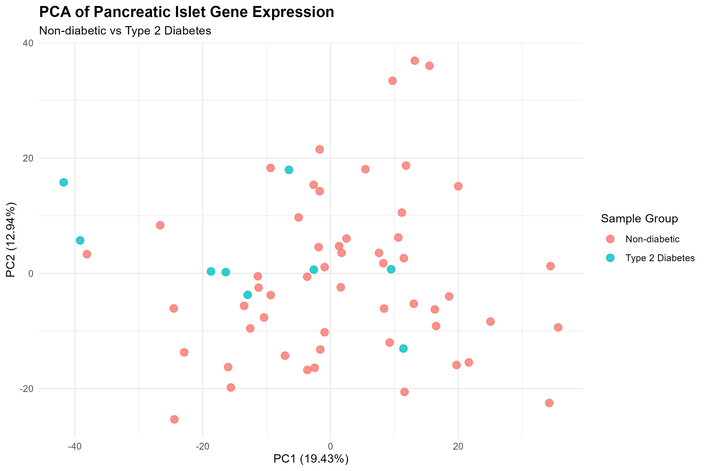
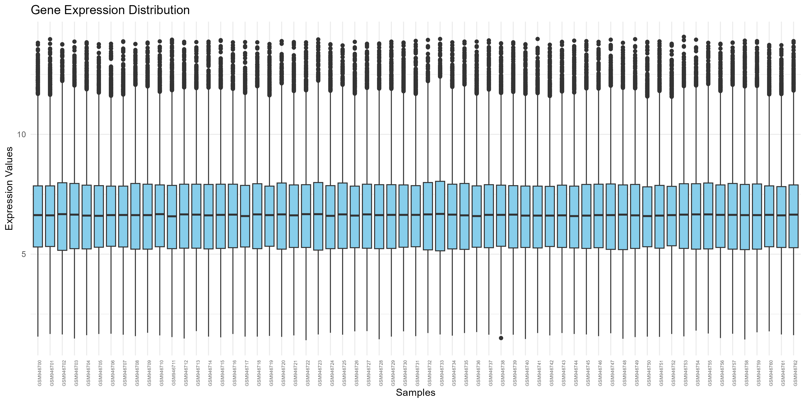
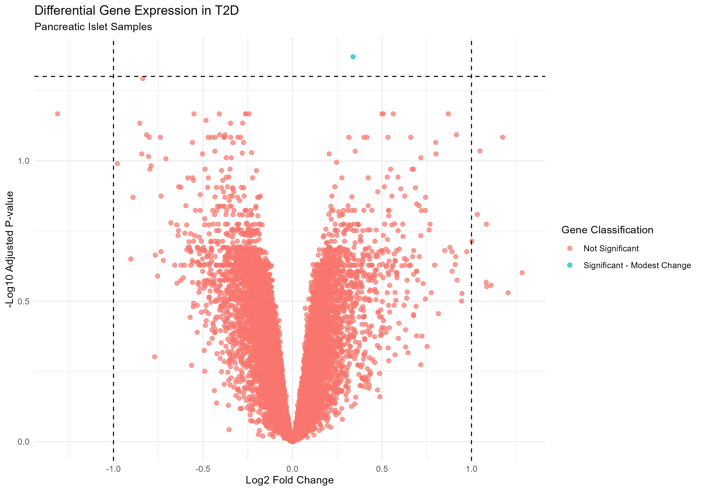
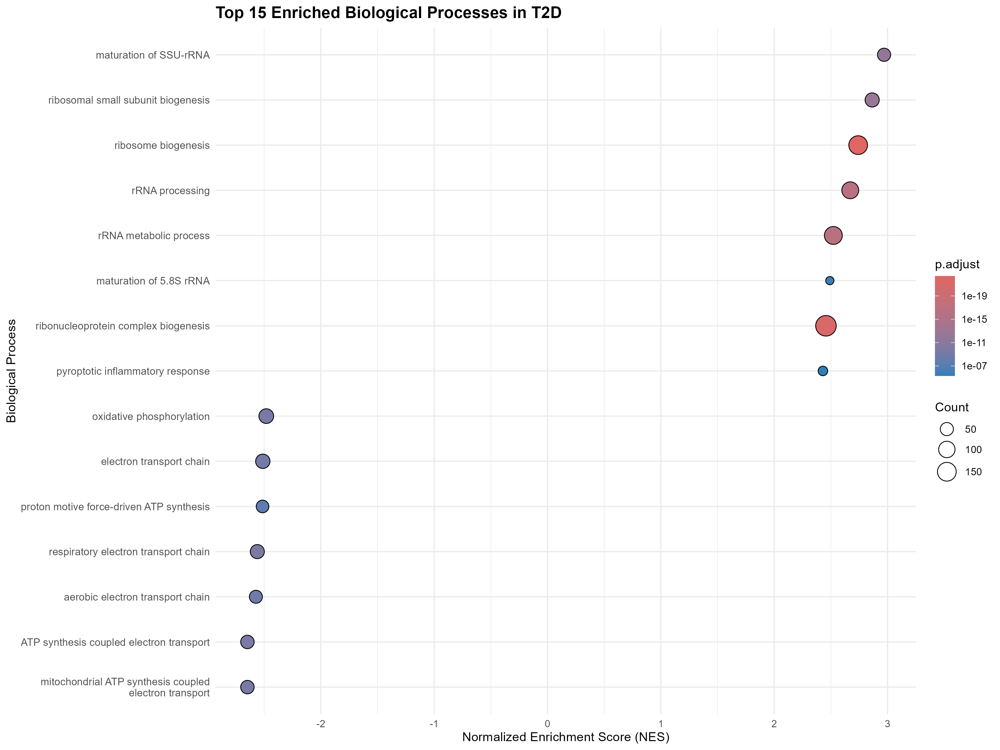
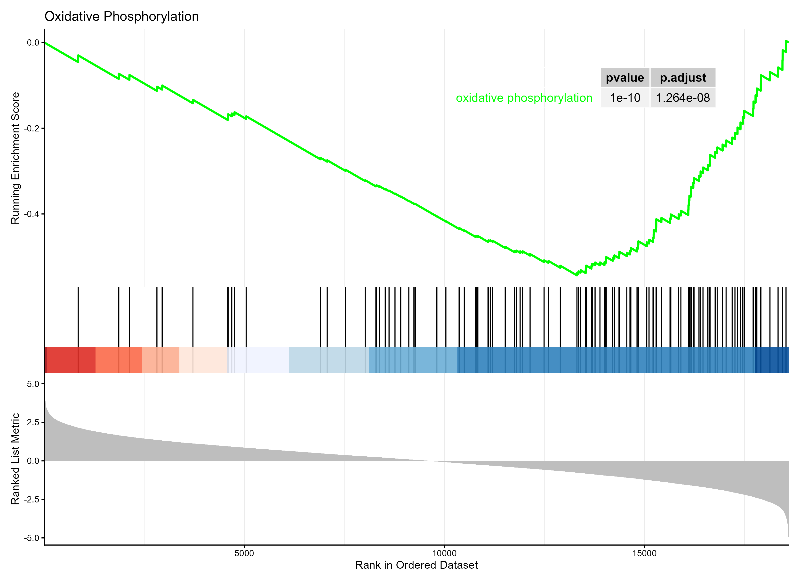

# Differential Gene Expression and Functional Enrichment Analysis of Type 2 Diabetes Using Pancreatic Islet Gene Expression Data

## Abstract

This project investigates gene-expression differences between pancreatic islet samples from people with Type 2 Diabetes (T2D) and non-diabetic controls. The analysis uses the public NCBI Gene Expression Omnibus dataset GSE38642, containing 63 human donor samples (9 T2D and 54 controls) measured on the Affymetrix Human Gene 1.0 ST platform (GPL6244). The workflow in R includes data inspection, expression-distribution quality control, principal component analysis (PCA), differential-expression testing with limma, probe annotation, and Gene Ontology (GO) Biological Process gene set enrichment analysis (GSEA). The committed limma output contains one probe passing a Benjamini–Hochberg adjusted p-value threshold of 0.05. The GSEA output contains 5,688 tested GO terms, of which 1,245 have adjusted p-values below 0.05. These results are exploratory and depend on probe-to-gene mapping and the composition of the original dataset.

## 1. Introduction

Type 2 Diabetes is a metabolic disease involving impaired insulin action and inadequate insulin secretion. Pancreatic islets contain endocrine cells, including insulin-producing beta cells, and are therefore relevant tissue for studying molecular features associated with diabetes. Gene-expression measurements provide a way to compare transcriptional patterns between disease and control samples.

**Research question.** Which probe-level expression differences and coordinated biological-process patterns are observed between pancreatic islet samples from donors with T2D and non-diabetic donors in GSE38642?

**Aim.** To analyse pancreatic islet expression data and explore gene-level and pathway-level patterns associated with T2D.

**Objectives.** The project aims to (1) obtain and inspect a public expression dataset; (2) assess data completeness and sample-level expression distributions; (3) explore sample variation using PCA; (4) test for differential expression using limma; (5) annotate probes using the array platform annotation; and (6) perform GO Biological Process GSEA using a ranked gene list.

## 2. Dataset and data preparation

### 2.1 Source and characteristics

The expression data were obtained from the NCBI Gene Expression Omnibus (GEO). The project uses the GSE38642 series and GPL6244 platform.

| Attribute | Description |
|---|---|
| GEO series | [GSE38642](https://www.ncbi.nlm.nih.gov/geo/query/acc.cgi?acc=GSE38642) |
| Platform | [GPL6244](https://www.ncbi.nlm.nih.gov/geo/query/acc.cgi?acc=GPL6244) |
| Organism | *Homo sapiens* |
| Tissue | Pancreatic islets |
| Samples | 63 donors |
| T2D samples | 9 |
| Non-diabetic samples | 54 |
| Expression features | 18,808 probes |
| Platform technology | Affymetrix Human Gene 1.0 ST |

The repository contains the ExpressionSet object (`data/GSE38642_expression_set.rds`), expression matrix (`data/GSE38642_expression.csv`), sample metadata (`data/GSE38642_sample_info.csv`), and GPL6244 platform annotation (`data/GPL6244_annotation.csv`). The ExpressionSet object is the primary input to the analysis scripts. The expression values supplied for this analysis are already RMA-normalised according to the GEO series information; the workflow does not repeat background correction or normalisation.

### 2.2 Data handling and quality checks

The expression matrix is organised with probes in rows and samples in columns. Sample metadata are matched to expression columns by sample accession before group labels are assigned. Samples are classified as T2D or non-diabetic using the `status:ch1` metadata field. The scripts stop if a sample cannot be assigned to either group or if the metadata cannot be aligned with the expression matrix.

The inspection stage checks matrix dimensions, metadata, missing values, and duplicate sample names. The committed inspection summary reports 18,808 probes and 63 samples, with no missing expression values, no missing sample metadata values in the checked fields, and no duplicate sample names. A boxplot is generated to compare expression-value distributions across samples. These checks help identify obvious data-quality issues but do not establish that all biological or technical confounders have been removed.

### 2.3 Ethics and data use

This is a secondary analysis of an existing public GEO dataset. The project did not recruit participants, collect new patient information, or generate new clinical images. The original study's consent and ethics arrangements remain the responsibility of the source study. The dataset and platform records should be cited when the results are reused. No attempt is made to identify individual donors.

## 3. Methods

All analyses are performed in R. The principal packages are Biobase and GEOquery for expression-set access, limma for differential-expression analysis, tidyverse/dplyr and ggplot2 for data handling and visualisation, AnnotationDbi and org.Hs.eg.db for identifier checks, and clusterProfiler/enrichplot for GSEA and enrichment plots. pheatmap is used for the expression heatmap.

### 3.1 Exploratory analysis and PCA

A boxplot is used to inspect the distribution of expression values across the 63 samples. PCA is applied to the transposed expression matrix so that each row represents one sample and each column represents one probe. The first two components explain 19.43% and 12.94% of the variance, respectively, or 32.37% together. PCA is an exploratory view of the strongest sources of variation; it is not a supervised classifier and visual separation alone is not evidence of a disease-specific effect.

### 3.2 Differential-expression analysis

Differential expression is tested using the limma linear-model workflow. A design matrix is created for the Control and T2D groups, and the contrast is defined as `T2D - Control`. The model is fitted with `lmFit()`, the contrast is applied with `contrasts.fit()`, and empirical Bayes moderation is performed with `eBayes()`. Results are extracted for all probes and p-values are adjusted using the Benjamini–Hochberg procedure.

A probe is called statistically significant when its adjusted p-value is below 0.05. For the stated contrast, a positive log2 fold change indicates higher expression in T2D, while a negative value indicates lower expression in T2D. The `Regulation` field is assigned only after the adjusted-p-value criterion is met. The project does not use an additional fold-change threshold to define statistical significance.

### 3.3 Probe annotation

Differential-expression results are joined to the GPL6244 platform table using probe identifiers. Annotation fields are retained because a probe may map to transcript, genomic, or gene identifiers and may not correspond to a unique protein-coding gene. Entrez identifiers are extracted from the platform's gene-assignment field and checked against the human annotation database before GSEA. When multiple probes map to the same Entrez identifier, the probe with the largest absolute moderated t-statistic is retained for the ranked list.

### 3.4 Gene set enrichment analysis

GO Biological Process GSEA is performed with `clusterProfiler::gseGO()`. The ranked input is based on limma moderated t-statistics, with Entrez Gene identifiers as names. The analysis uses the human `org.Hs.eg.db` annotation, `ont = "BP"`, gene-set sizes from 10 to 500, and Benjamini–Hochberg adjustment. The full result table is retained; pathways with adjusted p-values below 0.05 are separately saved for review.

A positive normalized enrichment score (NES) indicates enrichment toward the positive end of the ranked list, which corresponds to higher T2D-associated statistics for the `T2D - Control` contrast. A negative NES indicates enrichment toward the negative end. Enrichment is a coordinated rank-based association and should not be described as proof that a pathway is activated or inhibited.

## 4. Results

### 4.1 Data quality and sample variation

The analysed matrix contains 18,808 probes across 63 samples. The committed quality-control summary reports zero missing expression values and zero duplicate sample names. The PCA results report 19.43% variance explained by PC1 and 12.94% by PC2. Together, the first two components explain 32.37% of the observed variation. The PCA plot and sample-level coordinates are saved in `results/figures/PCA_plot.png` and `results/tables/PCA_results.csv`.

**PCA visualisation**



**Expression-distribution quality control**



[Download PCA coordinates (CSV)](results/tables/PCA_results.csv)

**Expression heatmap**


### 4.2 Differential expression

The committed limma results contain one probe with an adjusted p-value below 0.05. The significant result is:

| Probe | log2 fold change | Moderated t | P-value | Adjusted P-value | Direction |
|---|---:|---:|---:|---:|---|
| 8072314 | 0.338519 | 5.186328 | 2.262989 × 10⁻⁶ | 0.0425623 | Upregulated in T2D |

The positive log2 fold change corresponds to an estimated fold-change ratio of approximately 1.26 on the original expression scale. This is a modest difference. The probe is statistically significant at the selected adjusted-p-value threshold, but its effect size should not be overstated. The corrected classification is **Upregulated**, not “Not Significant”. The corrected summary contains 18,808 total probes, one significant/upregulated probe, zero significant/downregulated probes, and 18,807 probes not passing the adjusted-p-value threshold.

**Volcano plot**



[Download complete differential-expression results (CSV)](results/tables/differential_expression_results.csv) · [Download significance summary (CSV)](results/tables/significance_summary.csv) · [Download significant probes (CSV)](results/tables/significant_genes.csv)

### 4.3 Probe annotation

The platform annotation links probe 8072314 to LIF-AS2 (LIF antisense RNA 2; NCBI Gene ID 91370; Ensembl ID ENSG00000268812). LIF-AS2 is a non-coding RNA, so this result should not be presented as a protein-coding biomarker. The annotation is consistent with the platform's transcript and genomic fields. The annotation and identifier mapping should still be considered platform-dependent and checked again if a different genome build or annotation release is used.

[Download annotated probe results (CSV)](results/tables/annotated_gene_results.csv)

### 4.4 GO Biological Process GSEA

The committed GSEA output contains 5,688 GO Biological Process terms, with 1,245 terms having adjusted p-values below 0.05. Among the strongest positive NES results are ribosome biogenesis (NES 2.741), maturation of SSU-rRNA (NES 2.969), ribosomal small subunit biogenesis (NES 2.864), and cytokine-mediated signalling (NES 2.329). Negative NES results include oxidative phosphorylation (NES -2.481) and respiratory electron transport chain (NES -2.560). The complete output is saved in `results/tables/GO_GSEA_final_results.csv`, and the significant subset is saved in `results/tables/significant_GO_pathways.csv`.

**GO Biological Process enrichment visualisation**



**Oxidative phosphorylation enrichment**



[Download all GO GSEA results (CSV)](results/tables/GO_GSEA_final_results.csv) · [Download significant GO pathways (CSV)](results/tables/significant_GO_pathways.csv) · [Download top 15 GO pathways (CSV)](results/tables/Top_15_GO_pathways.csv)

These results suggest that ranked expression patterns in this dataset are associated with RNA/ribosome-related, immune-related, and mitochondrial energy-metabolism gene sets. GO terms overlap in their member genes and are not independent findings. A large number of significant terms should therefore be interpreted cautiously, especially given the small T2D group and the dependence of GSEA on gene-ID mapping and the ranked-gene universe.

## 5. Discussion

The analysis identifies one statistically significant probe after multiple-testing correction. Its positive log2 fold change indicates higher expression in the T2D samples relative to controls in this dataset. The mapped feature is LIF-AS2, a non-coding RNA. This observation is a candidate association for follow-up, not evidence that LIF-AS2 causes T2D or is suitable as a clinical biomarker. The small number of T2D donors means that the estimate may be sensitive to individual samples and unmeasured differences between donors.

The GSEA results provide a broader view than the single-probe significance result because GSEA evaluates coordinated changes across ranked genes. The positive enrichment of ribosome and RNA-processing terms and immune-related terms, together with negative enrichment of mitochondrial respiration terms, may indicate differences in cellular processes represented in the pancreatic-islet samples. However, the analysis is observational and computational. It cannot determine the cellular source of each signal, establish causal mechanisms, or show that a pathway is functionally activated or suppressed.

Several limitations affect interpretation. First, the groups are imbalanced: there are 54 controls but only 9 T2D samples. Second, the analysis uses a single public dataset and has no independent validation cohort. Third, microarray probes are not always equivalent to unique genes, and some annotation mappings may be incomplete or ambiguous. Fourth, the available model does not adjust for every possible donor-level covariate or technical batch effect. Fifth, GSEA results depend on the identifier conversion, duplicate-probe handling, gene-set definitions, and annotation database version. Finally, the pathway terms overlap and should not be counted as 1,245 separate biological discoveries.

Future work should test the findings in an independent pancreatic-islet dataset, assess sample-level influence and possible confounding variables, compare alternative probe-to-gene mapping strategies, and validate the LIF-AS2 association with an independent assay. Pathway results should be prioritised by gene overlap, effect direction, biological relevance, and replication rather than adjusted p-value alone.

## 6. Conclusion

This project implements an R-based workflow for exploring T2D-associated expression patterns in pancreatic islet samples from GSE38642. It includes data inspection, quality-control visualisation, PCA, limma differential-expression testing, platform annotation, and GO Biological Process GSEA. The committed results identify one significant probe, 8072314, with a modest positive log2 fold change and an annotation to LIF-AS2. The GSEA output reports multiple enriched biological-process terms involving RNA/ribosome biology, immune processes, and mitochondrial energy metabolism. The findings are exploratory and require replication, careful annotation review, and biological validation before any clinical interpretation.

## 7. Repository structure

```text
2021-ASP-43_Banuyah/
├── code/
│   ├── run_analysis.R
│   ├── 02_data_inspection.R
│   ├── 03_sample_grouping_PCA.R
│   ├── 04_differential_gene_expression.R
│   ├── 05_significant_gene_summary.R
│   ├── 06_gene_annotation.R
│   ├── 07_probe_annotation.R
│   ├── 08_heatmap.R
│   ├── EXTRACT_GENE_IDS.R
│   ├── ranked_genes_for_GSEA.R
│   ├── GSEA_DOT_PLOT.R
│   └── supporting annotation scripts
├── data/
│   ├── GSE38642_expression_set.rds
│   ├── GSE38642_expression.csv
│   ├── GSE38642_sample_info.csv
│   └── GPL6244_annotation.csv
├── results/
│   ├── figures/
│   ├── tables/
│   └── sessionInfo.txt (created after a successful run)
├── docs/                 # static project website
├── ICA3_Bioinformatics_2026.pdf
├── ICA.Rproj
├── .gitignore
└── README.md
```

## 8. Reproducibility

### Requirements

Use a current R installation and RStudio. Install CRAN and Bioconductor packages before running the workflow:

```r
install.packages(c("tidyverse", "ggplot2", "pheatmap", "stringr"))
if (!requireNamespace("BiocManager", quietly = TRUE)) {
  install.packages("BiocManager")
}
BiocManager::install(c(
  "Biobase", "GEOquery", "limma", "AnnotationDbi",
  "org.Hs.eg.db", "clusterProfiler", "enrichplot"
))
```

### Run the analysis

1. Download or clone the repository.
2. Open `ICA.Rproj` in RStudio, or set the working directory to the repository root.
3. Start a fresh R session.
4. Run `source("code/run_analysis.R")` from the repository root.
5. Inspect the regenerated CSV files and figures in `results/` and compare them with the committed outputs.

The master script checks for required packages and runs the analysis scripts in order. Some Bioconductor annotation resources may require an internet connection. The precomputed tables and figures are included so that the current reported outputs can be inspected without rerunning the workflow. Package versions can be recorded locally with `sessionInfo()` after a successful run. Because the analysis has not been executed in a clean R environment during preparation of this corrected copy, a successful end-to-end run must be confirmed in RStudio before submission; do not claim that the workflow has been independently validated until this check is complete.

## 9. References

1. Edgar, R., Domrachev, M., & Lash, A. E. (2002). Gene Expression Omnibus: NCBI gene expression and hybridization array data repository. *Nucleic Acids Research, 30*(1), 207–210. https://doi.org/10.1093/nar/30.1.207
2. Ritchie, M. E., et al. (2015). limma powers differential expression analyses for RNA-sequencing and microarray studies. *Nucleic Acids Research, 43*(7), e47. https://doi.org/10.1093/nar/gkv007
3. Subramanian, A., et al. (2005). Gene set enrichment analysis: A knowledge-based approach for interpreting genome-wide expression profiles. *Proceedings of the National Academy of Sciences, 102*(43), 15545–15550. https://doi.org/10.1073/pnas.0506580102
4. Wu, T., et al. (2021). clusterProfiler 4.0: A universal enrichment tool for interpreting omics data. *The Innovation, 2*(3), 100141. https://doi.org/10.1016/j.xinn.2021.100141
5. NCBI Gene Expression Omnibus. GSE38642 dataset. https://www.ncbi.nlm.nih.gov/geo/query/acc.cgi?acc=GSE38642
6. NCBI Gene Expression Omnibus. GPL6244 platform. https://www.ncbi.nlm.nih.gov/geo/query/acc.cgi?acc=GPL6244
7. NCBI Gene. LIF-AS2 (Gene ID: 91370). https://www.ncbi.nlm.nih.gov/gene/91370

---

**Project website:** The static website in `docs/` presents the project overview, workflow, selected results, figures, and data links. GitHub Pages can be enabled using the `main` branch and `/docs` folder; see [`docs/PUBLISH.md`](docs/PUBLISH.md).
